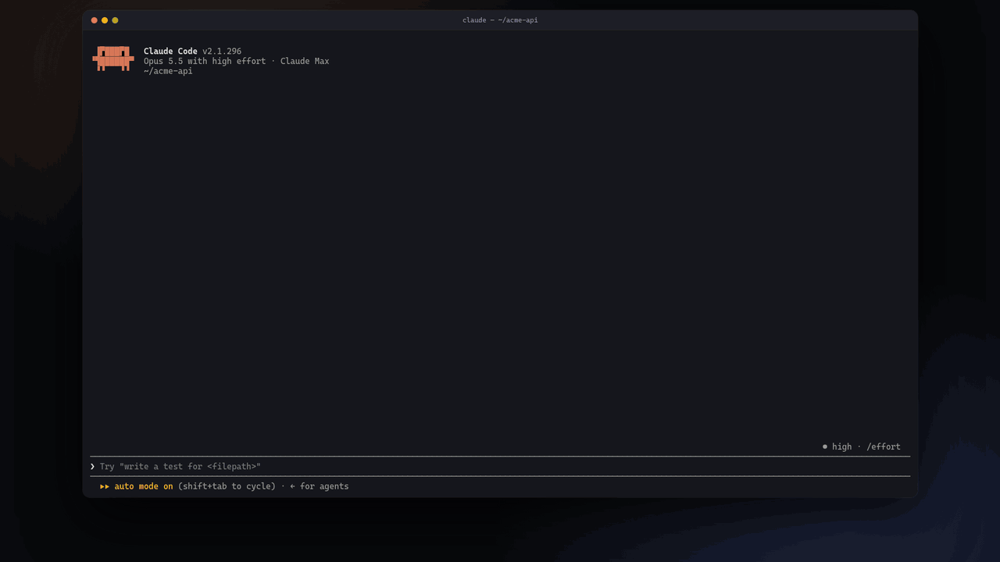

There's a thing that happens when you ask Claude for a workflow. It writes two hundred lines of orchestration, tells you it'll start nine agents, and asks if that's all right. You say yes. Most everybody says yes. Nobody reads the script.

Then the agents go off somewhere you can't see, and you sit watching a counter, hoping that what's burning your tokens is the thing you meant.

Conductor is a Claude Code mod for people who got tired of hoping. The workflow is a graph, in a pane beside your transcript. You draw it, or you tell Claude to and fix what it got wrong. When the plan is good, hand it over for build and run. The run comes back onto the same graph, block by block, so you know which agent failed, where, and what it cost you.

```
/plugin install workflow-conductor --marketplace bruw/workflow-conductor
```


## What you get

Type `/conductor review this PR thoroughly`. Claude drafts this and puts it on the board:

```
╭───────────────────────────────────────────────────────────────────── n6 ─╮
│ START                                                                    │
│ Review the current diff along several dimensions and keep only findings… │
╰──────────────────────────────────────────────────────────────────────────╯
                                     ↓  [+]
╭───────────────────────────────────────────────────────────────────── n1 ─╮
│ AGENT scout / scout diff                                             low │
│ Cheap and mechanical. Its list of dimensions is the work-list for the p… │
╰──────────────────────────────────────────────────────────────────────────╯
                                     ↓  [+]
┌╴ PIPELINE / review · once per: ×4 dimensions ╴╴╴╴╴╴╴╴╴╴╴╴╴╴╴╴╴╴╴╴╴╴╴ n2 ╴┐
╎ ╭───────────────────────────────────────────────────────────────── n3 ─╮ ╎
╎ │ AGENT / review                                                       │ ╎
╎ │ One reviewer per dimension.                                          │ ╎
╎ ╰──────────────────────────────────────────────────────────────────────╯ ╎
╎                                    ↓  [+]                                ╎
╎ ╭───────────────────────────────────────────────────────────────── n4 ─╮ ╎
╎ │ AGENT verify / verify findings                                       │ ╎
╎ │ 3 votes: each skeptic tries to refute a finding and defaults to ref… │ ╎
╎ ╰──────────────────────────────────────────────────────────────────────╯ ╎
└╴╴╴╴╴╴╴╴╴╴╴╴╴╴╴╴╴╴╴╴╴╴╴╴╴╴╴╴╴╴╴╴╴╴ [+] ╴╴╴╴╴╴╴╴╴╴╴╴╴╴╴╴╴╴╴╴╴╴╴╴╴╴╴╴╴╴╴╴╴╴╴┘
                                 all ⇓  [+]
╭───────────────────────────────────────────────────────────────────── n5 ─╮
│ AGENT merge                                                              │
│ Runs once over all surviving findings: merge duplicates, order by sever… │
╰──────────────────────────────────────────────────────────────────────────╯
```

You can read that in ten seconds. That's the whole point of it.

Don't like it? Say so, in plain words: *"add a verify with 3 votes after n3"*, *"set this block to low effort"*.

Then press `r`. Claude confirms the design, asks what to run it on, writes a real Workflow script from the project, and runs it. The board becomes the run:

```
╭───────────────────────────────────────────────────────────────────── n1 ─╮
│ AGENT scout / scout diff                                             low │
│ Cheap and mechanical. Its list of dimensions is the work-list for the p… │
╰─ ✗ 3/4 done · 1 failed · 20.4k ──────────────────────────────────────────╯
                                     ↓
┌╴ PIPELINE / review · once per: ×4 dimensions ╴╴╴╴╴╴╴╴╴╴╴╴╴╴╴╴╴╴╴╴╴╴╴ n2 ╴┐
╎ ╭───────────────────────────────────────────────────────────────── n3 ─╮ ╎
╎ │ AGENT / review                                                       │ ╎
╎ │ One reviewer per dimension.                                          │ ╎
╎ ╰─ ✓ 4/4 done · 30.6k ─────────────────────────────────────────────────╯ ╎
╎                                    ↓                                     ╎
╎ ╭───────────────────────────────────────────────────────────────── n4 ─╮ ╎
╎ │ AGENT verify / verify findings                                       │ ╎
╎ │ 3 votes: each skeptic tries to refute a finding and defaults to ref… │ ╎
╎ ╰─ ✓ 4/4 done · 40.8k ─────────────────────────────────────────────────╯ ╎
└╴ ✓ 8/8 done · 71.4k ╴╴╴╴╴╴╴╴╴╴╴╴╴╴╴╴╴╴╴╴╴╴╴╴╴╴╴╴╴╴╴╴╴╴╴╴╴╴╴╴╴╴╴╴╴╴╴╴╴╴╴╴╴┘
                                 all ⇓
╭───────────────────────────────────────────────────────────────────── n5 ─╮
│ AGENT merge                                                              │
│ Runs once over all surviving findings: merge duplicates, order by sever… │
╰─ · not run ──────────────────────────────────────────────────────────────╯
```

## Why a man might want it

- **You approve a design, not a script.** 
- **The project is a file in your repo.** `.claude/workflow-conductor/<name>.json`, with the script it was last run as beside it. It diffs. It reviews. The next run changes only what the project changed.
- **It tells you what's wrong and stops nobody.** A loop with no stop condition, a verify with nothing to check, a branch arm with no condition: each gets a ` ! ` on its card. You can run it anyway. It's your money.
- **It works on runs you never designed.** When Claude starts a workflow on its own, Conductor asks once whether to draw it. Say yes and the run shows up on a graph of the script that's already running.

## The parts

Eight blocks to rule them all. 
Three do work: `agent`, `code`, `subworkflow`. 
Four hold other blocks: `pipeline`, `parallel`, `loop`, `branch`. 
And `start`, which carries the goal.

A pattern is a **kind** of a block, and picking one fills in what the pattern needs:

| Block | Kinds |
| --- | --- |
| agent | task · scout · check · verify · judge · critic · merge · classify |
| loop | custom · count · pass · dry · converged · target · budget |
| parallel | arms · each · sweep · attempts |
| branch | if-else · guard · route |

Four templates to start from (`Review`, `Research`, `Migrate`, `Judge panel`), or a blank board.

## Getting around


| | |
| --- | --- |
| `/conductor` | the board: the live run, else the last project, else the start screen |
| `/conductor <description…>` | Claude drafts a new project from your words |
| `/conductor min` · `max` | fold the designer away, bring it back |

| Key | Does |
| --- | --- |
| `w` `a` `s` `d` | move the selection; with Shift, move the block |
| `Enter` | edit the block's fields |
| `n` `x` `t` | add a block, delete it, change its type or kind |
| `1` `2` | step the model, the effort |
| `o` `b` | open a container as the view, back up a level |
| `u` `y` | undo, redo: fifty steps a project |
| `r` | implement and run |
| `q` | ask Claude to review the design |
| `p` | projects and templates |
| `?` | every other key, and the mouse |

The mouse works too: click to select, drag the selected card to move it, wheel to scroll.


## What you need

- Claude Code 2.1.296 or later, with the Workflow tool.
- A terminal 110 columns wide, in the fullscreen layout. Narrower than that, you get the compact strip and no designer; widen it and the designer opens by itself.
- Fullscreen for the mouse. The keys work without it.

## Hack it

MIT. Get busy designing.

```
claude --plugin-dir /path/to/conductor
```

In the desktop app, where no flag can be given, the `env` of your user settings takes it:

```json
{ "env": { "CLAUDE_CODE_PLUGIN_DIRS": "/path/to/conductor" } }
```

- `bun install`, then `bun run check`: the plugin validation, `tsc` and the tests.
- `bun scripts/render-graph.ts --list` names what it can draw, and draws it with no session.
- `scripts/dev-session.sh` starts Claude Code with the mod in tmux; `scripts/send.sh` sends it keys, `scripts/capture.sh` prints the screen and the debug lines.
- `src/` is pure logic; `hooks/` is what Claude Code loads.

## What it touches

Conductor makes no network requests and reads no settings or credentials.

| Area | What Conductor does | What it never does |
| --- | --- | --- |
| Files | Writes only `.claude/workflow-conductor/<name>.json` under the session's root; `<name>` is always kebab-case. The `<name>.workflow.js` beside it is the project's Workflow script: Claude writes it with its own tools on a hand-off, and the Workflow tool runs it. | Write a file another tool runs, settings, `CLAUDE.md`, build or start-up files. Delete or rename a file: to remove or rename a project, remove or rename its files. |
| Programs | Nothing. | Run any program. |
| Prompts | Submits a prompt to your own session in two cases. `r`: `Implement and run the "<name>" workflow project (Conductor hands it off: call mcp__workflow-conductor__before_workflow first).` `/conductor <description>`: `Draft a workflow project: <description>`, your own words. `q` and the draft key only put a sentence in the prompt box for you to send. | Put file content or conversation text in a prompt it submits: only the project name, or your own words. Read the prompt box beyond whether it is empty. |
| Tools | Adds two tools of its own and answers every call to them itself, the only way a mod serves a tool it adds. `mcp__workflow-conductor__before_workflow`: Claude calls it before writing or running a Workflow script; Conductor asks you whether to design the workflow on the board first and answers with your choice, or with the one you told it to keep; subagents and `-p` runs get the standard answer without a question. `mcp__workflow-conductor__project`: Claude reads and edits a project with it (`read`, `apply`, `write`, `attach`); the project's goal, blocks and file paths reach Claude this way and in notes on the prompts you send while the board is open. | Answer another tool's call in that tool's place. |
| Claude's tools | Refreshes the board after a project file is written and tracks a started run. Refuses a write or edit of a project file while that project is running. Asks once whether to draw a `Workflow` run no project claims: a yes, or what you type instead, is added to the tool's result as a note to Claude. | Change Claude's own `Write`, `Edit` and `Workflow` calls otherwise. |
| Hooks | `/conductor` (`command.run`, on that command name alone): opens the board or the run view, folds or expands the designer, or starts a draft, the same whoever runs the command, you or other code. Subagent starts, model requests and turn ends (`agent.spawn`, `turn.step`, `turn.complete`): reads a workflow agent's id and label, a subagent's token usage and how its turn ended, to draw the run, and passes each on unchanged. The prompt box (`prompt.edit`): while the board is taking the keyboard back, one letter typed into the empty box goes to the board as a key instead. | Hook any other command. Read a prompt, instruction or tool description in the run hooks. |
